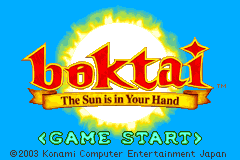
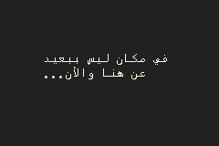
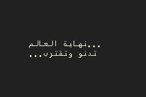
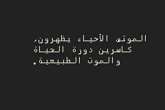

# Boktai: The Sun Is in Your Hand — Arabic Localization (تعريب باكتاي: الشمس في يدك)

تعريب عربي متكامل وهندسة عكسية للعبة **Boktai: The Sun Is in Your Hand (USA)** لجهاز **Game Boy Advance (GBA)**، يتضمن ترجمة كاملة للنصوص والحوارات والقوائم (**4,286** من أصل **4,299** نصاً مخزّناً)، خط عربي متصل **8×16 4bpp** (**133** شكلاً سياقياً مع علامات الترقيم العربية)، تعديل ثنائي لفتح نطاق الأحرف أحادي البايت (`0x20..0xFF`) داخل محرك نصوص Konami/KCEJ، ورقع **BPS** و **IPS** قانونية قياسية جاهزة للتطبيق.

Comprehensive Arabic fan translation, 8×16 4bpp connected Arabic pixel font pipeline (133 contextual presentation forms + lam-alef ligatures + Arabic punctuation), ARM/Thumb single-byte text engine unlock (`0x20..0xFF`), RTL shaping & GCL tag-safe re-encoder (`4,286 / 4,299` strings localized), and spec-compliant legal **BPS / IPS** delta patches for *Boktai: The Sun Is in Your Hand* (USA, `U3IE`, GBA).

---

## 📸 معاينات حية من داخل اللعبة / Live In-Game Screenshots

| شاشة البداية (Title Screen) | مقدمة القصة — 1 (Opening Prologue) |
|:---:|:---:|
| <br><sub>**شاشة البداية:** Boktai: The Sun Is in Your Hand (GBA)</sub> | <br><sub>**مقدمة القصة:** خط عربي متصل 8×16 بوضوح عالٍ واتجاه RTL سليم</sub> |

| مقدمة القصة — 2 (End of the World) | مقدمة القصة — 3 (The Undead Appear) |
|:---:|:---:|
| <br><sub>**تشكيل وربط سياقي:** ترابط سلس للحروف مع الحفاظ على الترقيم</sub> | <br><sub>**النصوص متعددة الأسطر:** عرض متوازن للفقرات العربية داخل محرك اللعبة</sub> |

---

## 🌟 مميزات المشروع / Project Highlights

1. **خط عربي متصل 8×16 4bpp (Connected Arabic Pixel Font):**
   - حقن **133** شكلاً سياقياً عربياً (منفصل، أولي، وسطي، نهائي + رابطات `لا / لأ / لإ / لآ` + علامات الترقيم `؟ ، ؛ « »`) في الخانات `0x7B..0xFF` داخل حاوية الخط (`0x0BA54C8` — MFT `0x6D24`).
   - مبني على خط **fresh36** العربي ومُكيَّف هندسياً بقاعدة خط موحدة (Row 11 baseline) وتعبئة بلاطات GBA 4bpp قياسية (64 بايت لكل محرف).
2. **تعديل محرك النصوص ARM/Thumb (Single-Byte Engine Unlock):**
   - تعطيل 3 تفرعات موقّعة (`blt` ← `mov r8, r8` / `C0 46`) عند الإزاحات `0x130BB6` و `0x130BEA` و `0x130C9E` لتجاوز روتين الكانجي ثنائي البايت وفتح كامل النطاق `0x20..0xFF` للاستدعاء المباشر أحادي البايت.
3. **محرك تشكيل واتجاه عربي (RTL Contextual Shaper & GCL Tag Preservation):**
   - تشكيل وربط سياقي وإعادة ترتيب من اليمين إلى اليسار (RTL) مع الحفاظ الكامل على وسوم محرك GCL (`<UVMOJI>`, `<NAME>`, `<LABEL>`, `<WAIT>`, `<WEIGHT>`) وأيقونات الأزرار (`\x80\xXX`).
   - فحص عكسي مطابق للبايت (Byte-identical round-trip) لجدول المؤشرات (`0x00E17AF0`, 4,299 مؤشر) وبيانات النصوص (`0x00E1BE1C`).
4. **رقع فروقية قانونية ونظيفة (Legal BPS & IPS Patches):**
   - لا يحتوي المستودع على أي ملف ROM أو بيانات أصلية محمية بحقوق النشر — فقط الأدوات المفتوحة، التوثيق، وجداول الترميز ورقع الفروقات (`patches/boktai_arabic.bps` و `patches/boktai_arabic.ips`).

---

## 🎮 طريقة تطبيق الرقعة / How to Patch

### 1. التحقق من الروم الأصلي (Source ROM Verification)

يجب تطبيق الرقعة على النسخة الأمريكية الأصلية النظيفة فقط:

| الخاصية / Property | القيمة / Value |
|---|---|
| الاسم / Filename | `Boktai - The Sun Is in Your Hand (USA).gba` |
| رمز اللعبة / Game Code | `U3IE` (`BOKTAI`) |
| الحجم / Size | `16,777,216` bytes (16.0 MB) |
| **CRC32** | `E715AC45` |
| **MD5** | `FF75C62AB690410CC8FCA24204D783E9` |
| **SHA-1** | `7164326283DF46A3941EC7B6CECA889CBC40E660` |

### 2. التطبيق باستخدام Flips (موصى به — BPS)

1. حمّل أداة **[Floating IPS (Flips)](https://github.com/Alcaro/Flips)** أو استخدم أداة تطبيق BPS عبر المتصفح مثل **[RomPatcher.js](https://www.marcrobledo.com/RomPatcher.js/)**.
2. اختر الرقعة `patches/boktai_arabic.bps` (أو حمّلها مباشرة من صفحة [Releases](../../releases/latest)).
3. اختر ملف الروم الأصلي النظيف `Boktai - The Sun Is in Your Hand (USA).gba`.
4. احفظ الناتج باسم `Boktai - The Sun Is in Your Hand (Arabic).gba`.

> **بديل مباشر على المحاكي (mGBA / VBA-M):** يمكنك وضع `boktai_arabic.bps` بجانب الروم الأصلي بنفس الاسم ليعمل التحميل التلقائي للرقعة.

### 3. التحقق من الناتج بعد التطبيق (Patched Output Verification)

| الخاصية / Property | القيمة / Value |
|---|---|
| الحجم / Size | `16,777,216` bytes |
| **CRC32** | `261340EC` |
| **SHA-1** | `9D3C2BF295A68479E6714CD37036958BD0C37B3A` |
| **SHA-256** | `325C04D2E5C6C82E65DED469D4CC0A1F14E1D12CF9FDFB402CC2D425784F2C68` |

---

## 📁 هيكل المستودع / Repository Structure

```text
boktai-the-sun-is-in-your-hand-arabic/
├── patches/
│   ├── boktai_arabic.bps            # Spec-compliant BPS1 delta patch (recommended)
│   └── boktai_arabic.ips            # Verified IPS delta patch
├── previews/                        # Live mGBA verification screenshots
├── encoding/
│   ├── charset_ar.tbl               # Arabic presentation-form byte table (0x7B..0xFF)
│   └── charset_us.tbl               # Base US character table
├── translation/
│   └── master_translations.json     # Arabic translation catalog (Arabic strings only)
├── tools/                           # Python font, RTL shaping, injection & patch tooling
├── docs/
│   ├── TECHNICAL.md                 # Reverse-engineering & memory map documentation
│   ├── PATCH_GUIDE.md               # Detailed Arabic patching guide
│   ├── TRANSLATION_NOTES.md         # Translation conventions & notes
│   ├── ROMHACK.md                   # Gate-by-gate engineering log
│   ├── glossary.md / glossary.json  # Bilingual localization glossary
│   └── build_info.txt               # Build hashes & verification record
├── checksums.sha256                 # SHA-256 verification hashes
├── requirements.txt                 # Python dependencies
└── LICENSE                          # MIT License
```

---

## ⚖️ التنبيه القانوني / Legal Notice

- هذا المشروع **ترجمة غير رسمية وغير تجارية** من إنتاج المعجبين.
- **لا يحتوي هذا المستودع على أي ملف ROM أو بيانات أصلية محمية بحقوق النشر.** يجب أن تمتلك نسخة أصلية قانونية من اللعبة.
- يُمنع إعادة توزيع الروم المعدّل (Patched ROM) — يُسمح بتوزيع الرقعة والأدوات فقط.
- *Boktai: The Sun Is in Your Hand* © Konami / KCEJ. All trademarks and copyrights belong to their respective owners.
